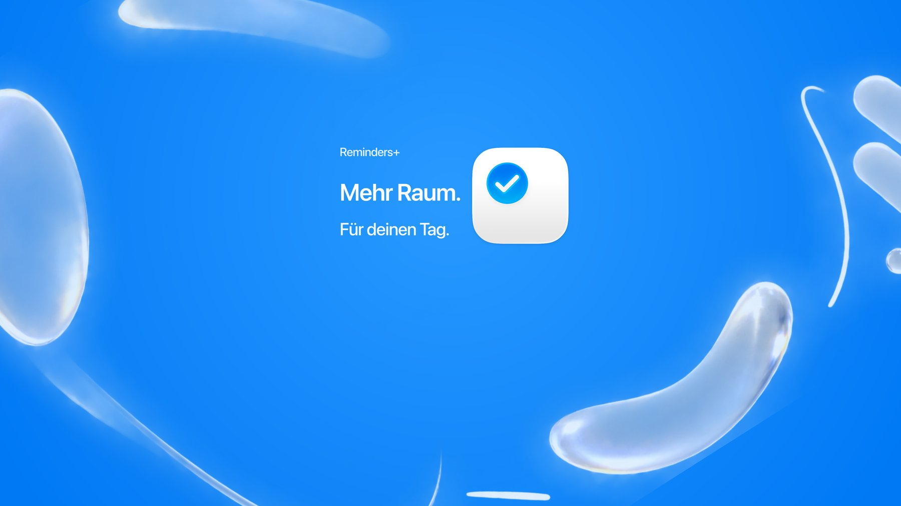
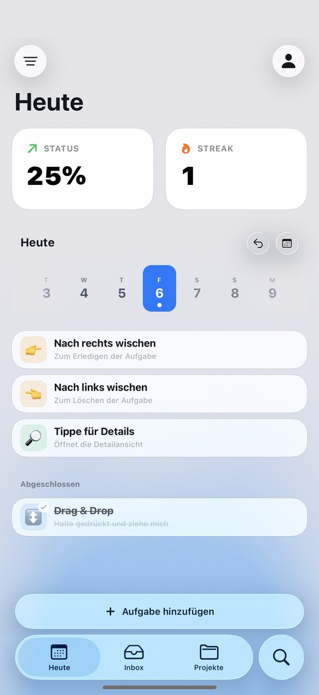
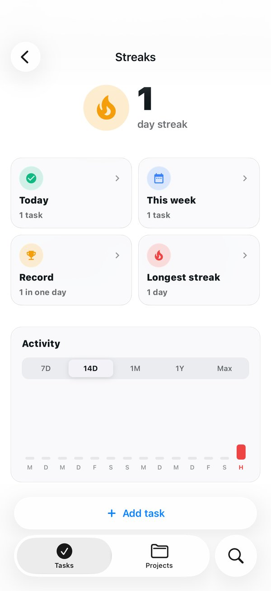
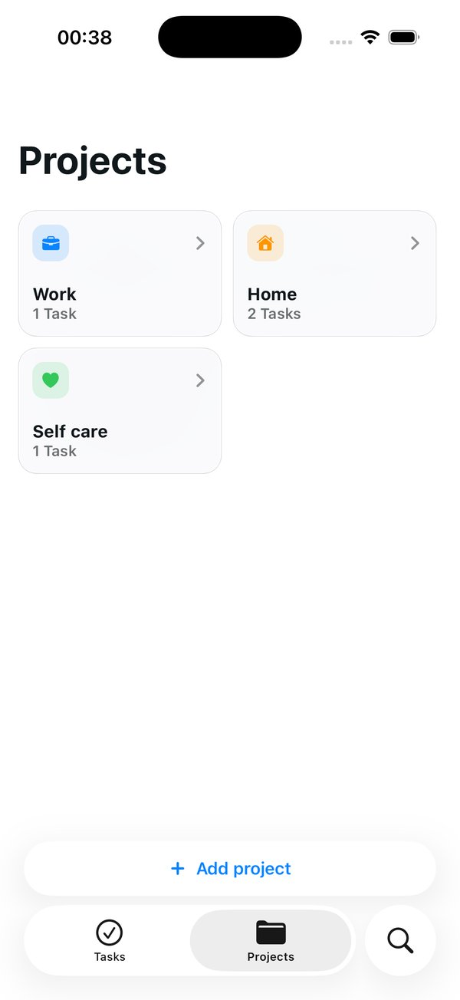
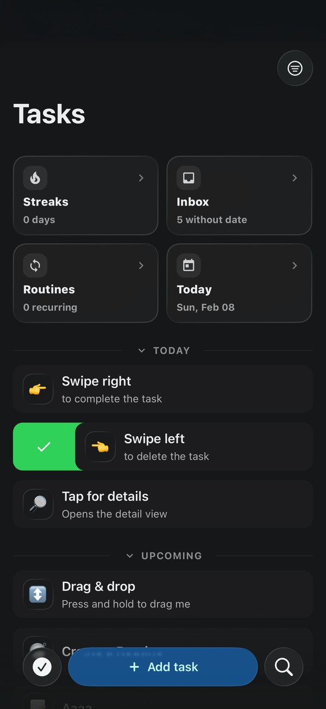
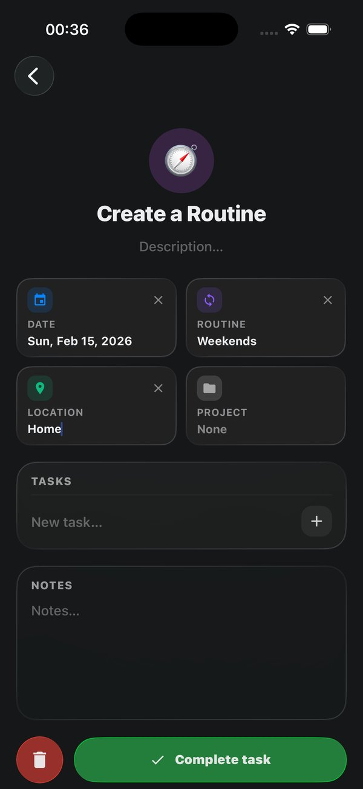
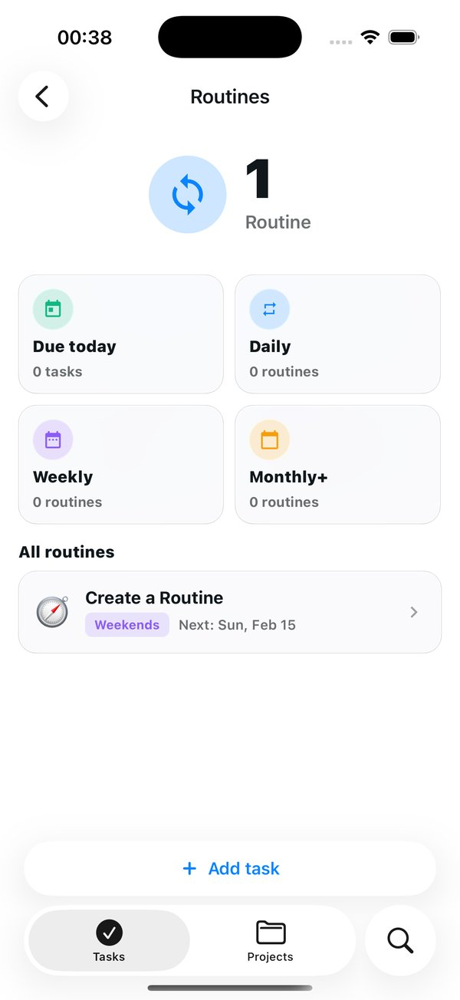

<div align="center">



# Reminders+

**Eine Aufgabe am Tag. Aufgaben, Routinen und Streaks in einer ruhigen App.**

[](https://apps.apple.com/us/app/reminders/id6758573672)


[Website](https://github.com/bnbln/reminders-plus-landingpage) · [Widgets](docs/ios-widgets.md) · [Barrierefreiheit](docs/accessibility-ios.md) · [iPhone Duo](docs/iphone-duo.md) · [Offene Aufgaben](docs/offene-aufgaben.md) · [Entwicklung](#entwicklung)

</div>

<br>



<table>
  <tr>
    <td></td>
    <td></td>
    <td></td>
  </tr>
  <tr>
    <td></td>
    <td></td>
    <td></td>
  </tr>
</table>

## Worum geht’s

Reminders+ ist eine Aufgaben- und Routinen-App, die auf Beständigkeit setzt statt auf endlose To-do-Listen. Das Prinzip ist einfach: Erledige jeden Tag mindestens eine Aufgabe, dann wächst dein Streak. Aufgaben, Routinen und Projekte liegen in einer Liste, die sich mit Wischen und Ziehen bedienen lässt. Ein Konto braucht es nicht, die Daten bleiben auf dem Gerät.

### Was Reminders+ kann

- 🔥 **Tägliche Streaks.** Eine erledigte Aufgabe pro Tag hält die Serie am Leben, mit Aktivitätsverlauf, Rekord und längster Serie.
- ✅ **Aufgaben und Routinen.** Fällig heute, diese Woche oder wiederkehrend von stündlich bis jährlich, auch nur an Werktagen oder am Wochenende, mit Ort, Projekt, Emoji-Stil und Notizen.
- 👆 **Wischen und Ziehen.** Nach rechts wischen erledigt, nach links löscht, per Drag & Drop wird sortiert oder auf einen anderen Tag verschoben.
- 🗂️ **Projekte.** Aufgaben nach Bereichen bündeln, bis zu 4 Projekte kostenlos.
- 🧩 **Widgets.** Streak und „Heute“ auf Home- und Sperrbildschirm, Aufgaben direkt im Widget abhaken.
- 📥 **Import von Apple.** Erinnerungen aus Apple Erinnerungen und Termine aus Apple Kalender als Aufgaben übernehmen.
- 🎨 **Eigener Look.** Hell und dunkel, Akzentfarben und ein App-Icon, das die gewählte Farbe annimmt.
- 🌍 **25 Sprachen.** Deutsch, Englisch, Spanisch, Französisch, Portugiesisch, Italienisch, Niederländisch, Schwedisch, Dänisch, Finnisch, Polnisch, Tschechisch, Ungarisch, Rumänisch, Griechisch, Türkisch, Russisch, Ukrainisch, Arabisch, Hindi, Indonesisch, Vietnamesisch, Chinesisch, Japanisch und Koreanisch.
- 📱 **iPhone, iPad und iPhone Duo.** Native Tabs und Navigation, die auf allen Größen mitwandern.

### Reminders+ Plus

Die App ist kostenlos, inklusive Streaks, Routinen, Widgets und Datenexport. Plus gibt es als Monatsabo oder als Lifetime-Einmalkauf über den App Store und bringt:

- **KI-Assistent.** Aufgaben in normaler Sprache anlegen, finden und verschieben, über Apple Intelligence (Foundation Models) direkt auf dem Gerät.
- **Mehr als 4 Projekte.**
- **iCloud-Sync** zwischen iPhone und iPad über das eigene iCloud-Konto.

### Datenschutz

Keine Analytics, keine Werbung, kein Konto, kein eigener Server. Aufgaben liegen auf dem Gerät, der optionale Sync läuft über CloudKit im iCloud-Konto der Nutzer:innen. Das Privacy-Manifest deklariert keine erfassten Daten. Alle Daten lassen sich jederzeit kostenlos als JSON exportieren.

---

## Entwicklung

### Voraussetzungen

- Node.js und npm
- Xcode mit iOS-SDK, CocoaPods
- Für Android: Android Studio (die App läuft dort ohne Assist und iCloud-Sync)

### Setup

```bash
npm install          # wendet danach die Patches aus patches/ an
npm run ios          # Dev-Build im Simulator
npm run ios:device   # Dev-Build auf einem angeschlossenen Gerät
```

Weitere Skripte: `npm start` (Metro), `npm run android`, `npm run lint`.

> [!IMPORTANT]
> Native Einstellungen wie iCloud-Entitlements, App-Icons und Pod-Settings kommen aus den Config-Plugins in `plugins/`. Nicht nur in Xcode umschalten, weil `expo prebuild` solche Änderungen zurücksetzt.

### iCloud-Sync (CloudKit)

Die eigenen CloudKit-Record-Types müssen für TestFlight- und App-Store-Builds im **Production**-Schema existieren.

1. Einen Dev-Build auf einem echten Gerät starten und Cloud Sync einmal auslösen, damit das Development-Schema entsteht.
2. Das CloudKit Dashboard für den Container (`iCloud.<bundleIdentifier>`) öffnen.
3. Den Record-Type `RemindsSyncSnapshot` samt Feldern von Development nach Production deployen.

Fehlt das Production-Schema, weicht die App auf den iCloud Key-Value Store aus. Der hat ein engeres Größenlimit und ist nur als Übergang gedacht. Die Entitlements verwaltet `plugins/with-ios-cloud-sync.js`.

### Struktur

| Pfad | Inhalt |
|---|---|
| `app/` | Screens mit Expo Router: `(tabs)/` (Heute, Inbox, Projekte in `explore/`, Routinen, Suche, Assistent), `task/` und `project/` (Detail und Modals), `plus.tsx`, `settings.tsx`, `cloud-sync.tsx`, `assist.tsx` |
| `components/` | UI-Bausteine: Aufgabenliste mit Swipe und Drag (`tasks/`), Navigation, Suche, Einstellungen, Streak-Feier, Widget-Sync |
| `context/` | Zustand: Aufgaben, Einstellungen, Plus, Filter, Snackbar |
| `widgets/` | Streak- und Heute-Widget mit `expo-widgets` ([Doku](docs/ios-widgets.md)) |
| `modules/` | Eigene native Module: `app-icon` (Akzent-Icons), `assist-llm` (Foundation Models) |
| `services/`, `storage/`, `notifications/` | iCloud-Sync, lokale Speicherung, Benachrichtigungen |
| `i18n/locales/` | Übersetzungen in 25 Sprachen |
| `plugins/` | Config-Plugins für iCloud, App-Icons, Pods und Android-App-Name |
| `patches/` | `patch-package`-Patches für Drittbibliotheken |
| `docs/` | Konzepte, Audits und offene Aufgaben |

### Dokumentation

- [Offene Aufgaben](docs/offene-aufgaben.md)
- [iOS-Widgets](docs/ios-widgets.md)
- [Barrierefreiheit auf iOS](docs/accessibility-ios.md)
- [iPhone Duo](docs/iphone-duo.md)
- [Upgrade auf Expo 58 und iOS 27](docs/expo58-ios27-upgrade.md)
- [UX/UI-Schema](docs/reminds-ux-ui-schema.md)

---

<sub>Die Landingpage liegt in [bnbln/reminders-plus-landingpage](https://github.com/bnbln/reminders-plus-landingpage).</sub>
