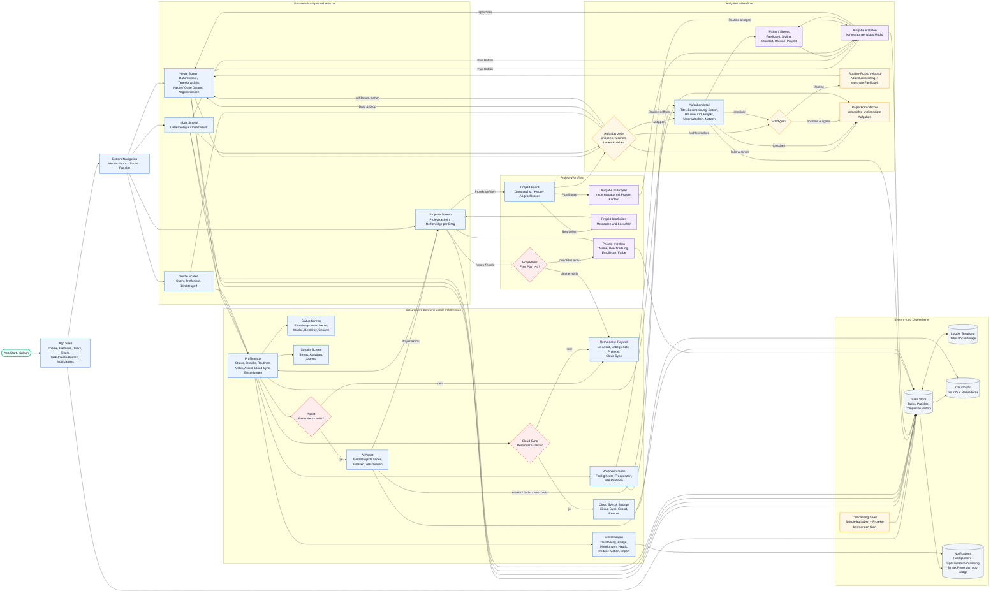

# Reminds UX/UI Schema

Dieses UX/UI-Schema beschreibt die wichtigsten Screens, Einstiegspunkte und Kernfunktionen der Reminds App als Markdown-kompatibles Mermaid-Diagramm. Der Diagrammtyp ist eine kombinierte Informationsarchitektur mit Haupt-User-Flow: blaue Knoten sind Screens, violette Knoten sind Modals/Sheets, rote Knoten sind Gates oder Entscheidungen und graue Knoten sind System-/Datenfunktionen.

## UX-Leselogik

- Der Hauptpfad startet in `Heute`: Nutzer planen Aufgaben ueber Datum, Listenabschnitte, Swipe-Gesten und Drag & Drop.
- `Aufgabe erstellen` ist kein eigener Tab, sondern ein kontextabhaengiges Modal. Der gleiche Flow wird aus Heute, Inbox, Projekt und Routinen genutzt.
- `Aufgabendetail` ist der zentrale Bearbeitungsort fuer Eigenschaften, Unteraufgaben, Notizen, Abschluss und Loeschen.
- `Projekte` erweitern die Aufgabenliste zu einem Kanban-Board mit den Spalten `Demnaechst`, `Heute` und `Abgeschlossen`.
- `Status`, `Streaks`, `Routinen`, `Archiv`, `Assist`, `Cloud Sync` und `Einstellungen` sind sekundäre Bereiche ueber das Profilmenue.
- Reminders+ wirkt als Premium-Gate fuer AI Assist, Cloud Sync und mehr als vier aktive Projekte.
